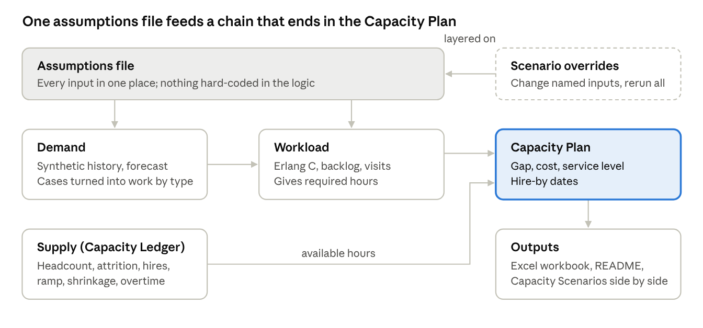

This spec defines a weekly, 52-week capacity model for a fictional multi-site medical-records request operation, built in Python by Claude Code from Siri's design. It is the Session 1 deliverable and was approved by Siri on 10/21/2026. Changes after approval are logged in Section 10.

**Honesty rules for everything built from this spec**

- All data is synthetic: generated by code to look realistic, never real company data.
- Every default number below is an illustrative starting assumption, not an industry benchmark. Session 2 tunes them; the README says so.
- The healthcare setting is a modeling scenario. It does not represent any real organization's process, and it does not claim healthcare, release-of-information, or medical-records experience. It shows modeling skill, described as a personal project.
- Confirmed by Siri on 10/20: 52-week weekly horizon, 80/20 phone service level, full-model scope including a dashboard and a designed user interface.

# 1. The fictional operation

**Northbrook Records Services** (fictional) fulfills requests for medical records on behalf of client hospitals and clinics. Requests come from patients, other providers, insurers, attorneys, and government agencies. Each request moves through intake, authorization validation, record retrieval, quality review and redaction, and release. Requests received per site are the single demand driver. A built-in routing process sends any misdirected request to the right site before it is counted, so each counted request is exactly one piece of work for that site.

**Sites and clusters.** A site is one client facility, where onsite associates are based and where requesters can walk in. 6 sites in 2 clusters of 3: Cluster North (sites N1, N2, N3) and Cluster South (sites S1, S2, S3). A cluster is a group of sites close enough to cover each other on short notice. Staff belong to a home site or the remote team; cluster coverage is temporary help, not a transfer.

**Coverage events.** Each time one site covers another, or a shortfall goes uncovered, the model records a coverage event. Its fields are defined in 6.7. The table exists from the start so synthetic history can include events and later analysis can show how often, where, and why coverage was needed.

**Staff pools (skill-based, no transfers)**

| Pool | Roles | Work | Breaks and lunch |
|---|---|---|---|
| Onsite | Onsite Associates, one team per site | Walk-in requesters, phones, site emails and portal messages | Required paid breaks, unpaid lunch |
| Onsite | Records Specialists, 2 per site | Non-digital retrieval, digitization, missing-record searches, certified copies; when idle, they help with walk-ins and phones | Required paid breaks, unpaid lunch |
| Remote | Remote Fulfillment Specialists, Tier 1 and Tier 2 | The request pipeline, routed by request type | Required paid breaks, unpaid lunch |
| Remote | QA Specialists, a dedicated team | All QA: quality review, the QA sample of automated work, and rework | Required paid breaks, unpaid lunch |

Skills run one way: Records Specialists also hold the Onsite Associate skills, but Onsite Associates do not handle non-digital records. Two Records Specialists per site is a staffing floor, so a site keeps its records coverage even when non-digital volume is low.

**Request types and skills.** Work routes by skill, and each tier is sized to its own work. Approved 10/21. Charts per request lets one bulk request (R5) multiply retrieval, review, and release work without adding intake work; bulk requests are worked in the daily queue.

| # | Request type | Share | Skill tier | Charts per request |
|---|---|---|---|---|
| R1 | Patient, own records | 35% | Tier 1 | 1 |
| R2 | Patient-directed to a third party (family, app, personal representative) | 5% | Tier 1 | 1 |
| R3 | Provider continuity of care | 10% | Tier 1 | 1 |
| R4 | Insurance and payer, claims and utilization review | 12% | Tier 2 | 1 |
| R5 | Payer audit and risk adjustment (bulk chart retrieval) | 8% | Tier 2 | 10 |
| R6 | Life and disability insurance, underwriting and claims | 5% | Tier 2 | 1 |
| R7 | Legal, attorney with patient authorization | 7% | Tier 2 | 1 |
| R8 | Legal, subpoena or court order | 5% | Tier 2 | 1 |
| R9 | Government and agency (disability determination, workers' comp) | 8% | Tier 2 | 1 |
| R10 | Records amendment or correction request | 3% | Tier 2 | 1 |
| R11 | Research and other | 2% | Tier 2 | 1 |

**Work types (approved 10/21; revise as new work comes up)**

| # | Stage | Work type | Owner | Model | Applies to | Handle time | Automation: eligible · exceptions · QA |
|-------|----------|--------------|----------|--------|-----------|--------|-------------|
| W1 | Intake | Request intake and logging | Tier 1 | Backlog | Every request | 6 min | Yes · 10% · 5% |
| W2 | Intake | Requester identity verification | Tier 1 | Backlog | Every request | 4 min | Yes · 15% · 10% |
| W3 | Intake | Fee and invoice processing | Tier 1 | Backlog | Billable requests, R4 to R7 (32%) | 3 min | Yes, rule-based · 5% · 2% |
| W4 | Intake | Misroute handling | Tier 1 | Backlog | 2% of requests | 3 min | Yes · 10% · 5% |
| W5 | Validation | Authorization validation | By request type | Backlog | Every request | 5 min Tier 1; 12 min Tier 2 | Yes · 15% · 10% |
| W6 | Validation | Incomplete-request outreach | Tier 1 | Backlog | 12% of requests | 8 min | Yes, AI drafts · 20% · 10% |
| W7 | Validation | Legal and sensitive-records review | Tier 2 | Backlog | All R8, plus 8% of others | 15 min | Human sign-off required · automation preps · 100% |
| W8 | Retrieval | Digital retrieval | By request type | Backlog | 85% of charts | 10 min, from the record-media table | Yes · 10% · 5% |
| W9 | Retrieval | Email-archive retrieval | Tier 1 | Backlog | 4% of charts | 20 min, from the record-media table | Yes · 20% · 10% |
| W10 | Retrieval | Multi-source compilation: imaging, lab, other departments | By request type | Backlog | 10% of charts | 10 min | Yes · 20% · 10% |
| W11 | Retrieval | Onsite retrieval: paper, microfiche, archive room | Records Specialists | Backlog | 11% of charts | 25 to 45 min by media | Yes; physical work, default rate 0% |
| W12 | Retrieval | Digitization | Records Specialists | Backlog, item by item | 1 per onsite retrieval | 15 min | Yes, auto-indexing · 15% · 10% |
| W13 | Retrieval | Missing or misfiled record search | Records Specialists | Backlog | 1% of charts | 30 min | Yes, AI-assisted search · 30% · 10% |
| W14 | Review | Quality review | QA team | Backlog | 100% of charts for R5, R7, R8, and any chart needing redaction; a 10% sample of all other charts | 6 min | Yes · 10% · 5% |
| W15 | Review | Sensitive-information redaction | Tier 2 | Backlog | 20% of charts | 8 min | Yes, AI-assisted · 15% · 100% |
| W16 | Release | Release and delivery | Tier 1 | Backlog | Every request | 3 min | Yes · 5% · 5%; R8 releases: human sign-off required, 100% |
| W17 | Release | Certified copies and notarization | Records Specialists | Backlog | R7, R8, and 20% of R4 (about 14%) | 10 min | Copies yes · 5% · 5%; notarization (the R8 path): human sign-off required, 100% |
| W18 | Release | Disclosure log entry | Tier 1 | Backlog | Every release | 1 min | Yes, rule-based · 2% · 2% |
| W19 | Onsite | Walk-in requester | Onsite Associates | Erlang C | 0.15 per request | 8 min | Yes, self-service kiosk, demand side |
| W20 | Onsite | Status and help calls | Onsite Associates | Erlang C | 1.0 per request | 5 min | Deflection, demand side |
| W21 | Onsite | Emails and portal messages | Onsite Associates | Backlog | 0.8 per request | 4 min | Deflection, demand side |
| W22 | Follow-up | Rework from QA failures | QA team | Backlog | 3% of reviewed items | Half the original time | Yes · 15% · 10% |
| W23 | Follow-up | Amendment tracking to closure | Tier 2 | Backlog | All R10 | 10 min | Yes · 10% · 10% |
| W24 | Review | Fulfiller self-check (added 10/22) | By request type | Backlog | Every chart | 1 min | Yes; default rate 0% |

**Human sign-off required.** Where a legal requirement says a person must decide, automation may do the prep, but every item goes to a person for the final decision. The sign-off rate is an input set to 100% for these rows. It can change in a future state, but only after a proof of concept shows the automation working without error, and only where the legal requirement allows. Which steps legally need a person is set per row and should be confirmed for any real deployment.

**Record media.** Most records are digital and housed in the client's system, but the model makes room for older formats, including records old enough to sit in archive rooms. Every non-digital item is tracked closely from request to retrieval to digitization.

| Media | Share (default) | Retrieved by | Retrieval time |
|---|---|---|---|
| Digital, in the client's system | 85% | Remote, by tier | 10 min (revised 10/22 from 12: represents a site converting to a workforce system) |
| Email archive | 4% | Remote, Tier 1 | 20 min |
| Paper file | 7% | Records Specialists | 25 min |
| Microfiche | 2% | Records Specialists | 35 min |
| Archive room (oldest records) | 2% | Records Specialists | 45 min |

The record-media table is the only source for retrieval times; W8, W9, and W11 read from it, so the times can never disagree. Each minute of digital retrieval time is worth about 1.6 FTE across the network.

**Digitization is its own work type.** Each non-digital item retrieved onsite is scanned, indexed, and checked so it never has to be pulled by hand again. Tracking it separately shows how much non-digital work remains and whether the backlog of old formats is shrinking.

Overall turnaround goal: 5 business days (illustrative). Regulatory deadlines vary and are not modeled as legal requirements. Up-training and corporate needs stay planned shrinkage, not queues.

**Output names.** The three outputs are the **Capacity Ledger** (week-by-week human and automated supply by site and role), the **Capacity Plan** (required vs. available, gap, cost, hiring timing), and **Capacity Scenarios** (side-by-side what-ifs).

# 2. How the model fits together

The model is a one-way chain: inputs live in one assumptions file, each module reads the one before it, and a scenario is just a different set of inputs run through the same chain. Grain is weekly, 52 weeks forward from Monday, January 4, 2027, with 156 weeks of synthetic history behind it, starting Monday, January 8, 2024 (revised 10/21; see Section 10). Every calculation runs per site and role, then rolls up to cluster and network.

{width=6.5in}

Required hours come from Demand and Workload; available hours come from Supply; the Capacity Plan compares them.

**Planned code layout** (Claude Code builds this; Siri reviews each file's purpose, not every line)

| File | Job | Session |
|---|---|---|
| assumptions.yaml | Every input, with comments | 2 |
| sites.yaml | Sites, size factors, clusters | 2 |
| skills.yaml | Which role can do which work type | 2 |
| generate_data.py | Synthetic history, including coverage events | 2 |
| forecast.py | Decomposition and Holt-Winters, holdout MAPE | 2 |
| erlang.py | Erlang C for phones and walk-ins | 3 |
| backlog.py | Back-office inventory model | 3 |
| intervals.py | Breaks and lunches by interval | 3 |
| supply.py | Ledger, cohorts, ramp, overtime | 4 |
| plan.py | Daily and weekly gap checks, cluster borrowing, overtime, cost | 4 |
| scenarios/ (one file each) | One overrides file per scenario | 5 |
| scenarios.py | Loads and merges scenario overrides (refuses unknown keys), applies each from its Starts week, holds the baseline roster, runs baseline plus scenarios, writes the side-by-side comparison (added 10/27) | 5 |
| export.py | Excel workbook | 6 |
| app/ | Dashboard and user interface | 6 and 7 |
| tests/ | Every validation check in Section 9 | 2 to 7 |
| config.py | Loads the YAML input files (added 10/21) | 2 |
| work_volume.py | Requests to weekly work volume by work type, with lags and chained work (spec 3.3; added 10/21) | 2 |
| coverage.py | Coverage events log, fields F1 to F24, cause suggestion (split from plan.py 10/26) | 4 |
| hiring.py | Hiring trigger, class sizing, hire-by dates, floor backfills, surplus flags (split from plan.py 10/26) | 4 |
| automation.py | Automated supply line (5.4), human-in-the-loop hours (5.5), eligibility, ramp, cap, and costs; reads only config so backlog.py and supply.py can both use it (added 10/27) | 4 |

# 3. Demand (Session 2)

Demand is weekly records requests received per site: 156 weeks of synthetic history, then a 52-week forecast. Every work type's volume is derived from requests, so one forecast drives everything. Requests are counted after routing, so none is counted at two sites.

**3.1 Synthetic history.** Generated from known ingredients, which is the point: because we chose the true growth and seasonality, the forecast can be graded against the answer.

> **Formula:** Requests (site, week) = base × site size × (1 + annual growth) ^ (week ÷ 52) × season × holiday × (1 + noise)

| Ingredient | Default |
|---|---|
| Base requests per site per week | 300 |
| Site size factor | N1 1.2, N2 1.0, N3 0.9, S1 1.1, S2 0.8, S3 1.0 (average 1.0, so the network total equals the base) |
| Annual growth | 6% |
| Season | +10% for weeks whose Monday falls January 1 to March 31; −8% for the week before Christmas week, a pre-holiday slowdown (revised 10/21: the original December 18 to 31 window never fired, because every week in it is a Christmas or New Year week). Set by calendar date, not week number, because some years have 53 weeks |
| Holiday weeks | ×0.6 (Thanksgiving, Christmas, New Year, July 4). Replaces the season factor in that week; never stacks on it |
| Request-type mix | As in Section 1, with relative drift: each share varies by a 5% standard deviation of its own size each week, then shares are rescaled to 100% |
| Noise | Normal, 5% standard deviation |
| Random seed | 20270104, so every run produces the same data |

**3.2 Forecast.** Classical decomposition as the baseline: seasonal index by week of year, linear trend on the de-seasonalized series, then recombine. Holt-Winters (statsmodels) runs alongside as a challenger. Both are scored on a 13-week holdout; the model reports MAPE for each and uses the better one. Found 11/03: decomposition wins on pooled site-week MAPE (4.27% vs 4.60%) but Holt-Winters wins on the network total (1.64% vs 1.82%), because site misses partly cancel when added up. Which method is better depends on the level you plan at; the model plans by site, so decomposition stays.

*Three points decided 10/21, when the build hit them:*

- **"Week of year" means position in a 52-week cycle anchored at the history start**, not the ISO week number. Same reasoning as the season windows in 3.1: 2026 is a 53-week ISO year, so ISO keying puts history's last week on an index the plan never uses, and leaves ISO week 1 with a single observation that happens to be a ×0.6 New Year week — the first plan week, an ordinary first-quarter week, would key to it and forecast about 55% of the truth. Cycle position pairs plan week *p* with history weeks *p*, *p*+52, and *p*+104.
- **History is 156 weeks, not 104.** Holt-Winters needs two full seasonal cycles (104 weeks) to initialise 52 seasonal indices, so a 13-week holdout off 104 weeks leaves 91 training weeks and statsmodels refuses to fit. With 156 weeks the training window is 143 and both methods get a genuine seasonal fit on the same holdout. The start date moves to Monday, January 8, 2024, which is exactly 156 weeks before the plan start.
- **One method is chosen for the whole network**, on pooled holdout MAPE across every site-week, rather than a per-site winner. Per-site selection forecasts slightly better but leaves the model a mix of methods that can flip site by site when an assumption changes. MAPE is still reported per site for both methods.

- **Plan holidays come from the calendar** (added 10/21). The forecast projects the normal pattern, then applies the holiday factor to each plan week that contains a named holiday, by date. Relying on cycle position alone works for 2027 but can misplace a holiday in other years, because holidays move against a 52-week grid.

Scoring is a true holdout: both methods train on the first 143 weeks and are scored on the last 13. The chosen method is then refitted on all 156 weeks to produce the 52-week forward forecast.

**3.3 From requests to work.** Some work follows the request by days or weeks. A lag profile per work type places it in the right week:

> **Formula:** Work volume (type, site, week) = the sum, over each lag week, of: requests in that earlier week × work per request for the type × the type's lag share for that week

Default lags for the 24 work types (approved 10/21):

| Work types | When the work lands |
|---|---|
| Intake and validation (W1 to W7), walk-ins (W19) | The week the request arrives |
| Digital and email retrieval, multi-source (W8 to W10) | 70% that week, 30% the next |
| Onsite retrieval, missing-record search (W11, W13) | 50% that week, 50% the next |
| Digitization (W12) | The week after its onsite retrieval |
| Review and release (W14 to W18, W24) | 50% that week, 50% the next |
| Calls and emails (W20, W21) | 50% that week, 50% the next |
| Rework (W22) | The week after its quality review |
| Amendment tracking (W23) | Spread evenly over 4 weeks |

**3.4 Intraday pattern.** Sites open Mon to Fri 8:00 to 17:00 local time, 18 half-hour intervals. Walk-ins peak late morning and early afternoon; calls peak 8:00 to 10:00. Erlang C needs this, because a week's average hides the peaks. Weekly work splits across days Monday 23%, Tuesday 21%, Wednesday 20%, Thursday 19%, Friday 17% (decided 10/22; requests build up over the weekend). Interval curves are drafted to match these peaks and approved by Siri from a chart before use. Revised 10/22: both calls and walk-ins get a modest lunch-hour bump (12:00 to 13:00), because people make a quick call or stop in on their own lunch break; walk-ins stay counted across all request types. Breaks and lunches are placed within their windows where the combined call and walk-in load is lightest, rather than spread evenly. Each window keeps its average share away (12.5% breaks, 16.7% lunch), no single interval may exceed 25% away (an input; decided 10/27: the cap applies to everyone away in that half-hour across all reliefs combined, breaks plus lunch), and load is ranked from the two arrival curves for now; once connected to work volume, it is weighted by volume × handle time.

# 4. Workload (Session 3)

Workload turns volume into the hours needed each week, per site and role, using the right math for each kind of work: Erlang C where people wait live (phones and the walk-in counter) and a backlog model for the request pipeline, where work can queue.

**4.1 Live queues: Erlang C per site, per half-hour interval.** Phones and walk-ins are both live queues: a caller on hold and a requester at the counter are waiting in real time. For each interval, traffic intensity A is arrivals times handle time over interval length. The model finds the smallest staff count N that meets the goal (phones 80% in 20 sec; walk-ins 90% within 10 min) without exceeding an 85% occupancy cap. Decided by Siri 10/22: at each site the counter and phones are one blended team, because at a small site the person at the counter answers the phone between walk-ins. Required staff comes from pooled Erlang C on the combined traffic, at the phones' stricter goal and a volume-weighted handle time, and is raised if needed until the walk-in goal also holds. Two tiny separate queues would run near 20% occupancy.

> **Formula:** Traffic A (in Erlangs) = arrivals per half hour × handle time in seconds ÷ 1,800
>
> **Formula:** Probability of waiting = X ÷ (Y + X), where X = (A^N ÷ N!) × N ÷ (N − A), and Y = the sum of A^k ÷ k! for k = 0 up to N − 1
>
> **Formula:** Service level = 1 − probability of waiting × e ^ (−(N − A) × target seconds ÷ handle time in seconds)

Teaching note: dividing weekly volume × AHT by 40 understates staff, because Erlang C staffs to each peak, and small single-site queues need proportionally more cushion than one large queue.

**4.2 Breaks and lunches (decided 10/22).** Every break is counted exactly once, with the method chosen by how each team works:

- **Phone and counter team (Onsite Associates): built into each interval.** Erlang C gives the staff needed at the counter and on the phones; scheduled staff covers people on break or at lunch, and hours are the sum of scheduled staff × 0.5 hour across the day. Paid breaks are therefore left out of this team's shrinkage (5.2). The peak check is built in, because every half hour must be covered on its own.
- **Back-office teams (Records Specialists, Tier 1, Tier 2, QA): through shrinkage.** Paid breaks stay in shrinkage, which turns work hours into FTE.
- **Onsite Associates' email and portal work** is backlog work done between live contacts. Decided by Siri 10/22: it is worked first in idle live-queue time, when applicable (scheduled hours minus live handle hours); only email work that doesn't fit adds hours, and only those spillover hours carry the 6.25% paid-break allowance.

> **Formula:** Scheduled staff in an interval = staff needed ÷ (1 − share of staff on break or at lunch in that interval)

Defaults: two paid 15-minute breaks, each taken somewhere in a 2-hour window (9:00 to 11:00 and 14:00 to 16:00), and one unpaid 30-minute lunch staggered 11:00 to 14:00. Spread evenly, that keeps about 12.5% of staff on break during each break window and about 16.7% at lunch during the lunch window. Teaching note: an unpaid lunch costs no pay but opens coverage holes midday, which is why small sites are often staffed for their peaks rather than their hours.

**4.3 Back office: backlog (inventory) model, weekly.** Work that can wait is planned by how much sits in the queue. Little's Law sets the healthy queue size: target backlog = daily arrivals × goal in days.

> **Formula:** Required hours = (arrivals + backlog above target ÷ catch-up weeks) × handle time in minutes ÷ 60

Given the hours actually available, the model projects forward:

- Completed = the smaller of (backlog + arrivals) or (available hours × 60 ÷ AHT)
- Next backlog = backlog + arrivals − completed
- Days of inventory = backlog ÷ (arrivals ÷ 5); goal met if at or below target

Defaults: starting backlog at target, catch-up period 4 weeks. Hours applied to a queue are capped at its required hours (decided 10/26): slack weeks hold a queue at target rather than emptying it, because a healthy back-office queue is not a queue of zero; unused hours are reported as surplus. Limitation, stated in the README: a weekly grain can't see within-day aging, so 1-day goals are checked as days of inventory, not true response time.

**4.4 Remote fulfillment by skill.** Each pipeline step's backlog is kept per tier. Hours per tier = items routed to that tier × that step's handle time for the request type ÷ 60. The skill matrix lists which tier may work each request type, and the model never assigns work to a tier without the skill. Overall turnaround is the sum of the five stages, where each stage is the volume-weighted average days of inventory of its work types, checked against the 5-business-day goal (decided 10/22). Steps inside a stage are alternatives or run side by side, so they are averaged, never added. Human-in-the-loop work (5.5) adds hours and cost to its role but is not a separate queue line in turnaround: each item counts once (decided 10/27). Decided 10/28: the headline turnaround is the requester's view, so every request counts once and automated items count at the machine's own completion time; the human-queue figure is kept as a secondary line for planners. (Found 10/28 to 11/02: measured on human queues only, the AI run looked worse in 18 weeks; in the requester's view it improves turnaround in step with realization. An apparent go-live dip was a queue-key bug, fixed 11/02, and is withdrawn.)

**Turnaround goals by stage (approved 10/22).** Goals are in business days; the five stages add to the 5-day overall goal. They were missing from the 24-type work table, restored here.

| Stage | Goal | Work types and exceptions |
|---|---|---|
| Intake | 0.5 (same day) | W1 to W4 |
| Validation | 1 | W5, W6; W7 legal and sensitive-records review 2 |
| Retrieval | 2 | W8 to W10 at 2; W11 onsite retrieval and W13 missing-record search at 3 |
| Review | 1 | W14, W15, W24 |
| Release | 0.5 | W16, W18; W17 certified copies and notarization 1 |

Off the request's path, so not counted in the 5 days: W12 digitization 10 days after retrieval; W22 rework 1 day; W23 amendment tracking 10 days; W21 onsite email 1 day, worked in idle time.

**Finding, kept 10/22:** weighted by real volumes, these goals give a fully staffed baseline of **5.23 business days**, about a quarter-day past the 5-day goal. The overshoot comes entirely from the three exception steps: legal and sensitive-records review +0.10, onsite retrieval and missing-record searches +0.10, certified copies +0.03. Intake and review, with no exceptions, sit exactly on goal. So the 5-day promise can't be met for every request even when fully staffed; a leader would either give legal and old-format requests their own turnaround promise, or make routine work run faster to absorb them.

**4.5 Onsite priority.** Onsite Associates protect live work first (walk-ins, then phones), then site emails and portal messages. Records Specialists work onsite retrieval first (a request is waiting on it), then digitization, and give half of their idle hours to walk-ins and phones at their own site, spread across the day (decided 10/26: they aren't always free when the counter needs them). When hours run short, digitization slips first and the tracker shows it.

**4.6 Non-digital tracking.** Each non-digital item carries its own record: site, media type, date requested, date retrieved, date digitized. The model reports open items by media and age, the share of requests still needing onsite retrieval, and the digitization backlog against its 10-business-day goal. As items are digitized, the non-digital share for future requests can fall; how fast depends on the digitization scenario in Section 7.

# 5. Supply (Session 4)

Supply tracks each site's people by role, week by week, and converts them into productive hours: headcount, minus attrition, plus hiring classes that count only once trained (and cleared for system access) and ramped, minus shrinkage, plus any overtime. This record is the **Capacity Ledger**.

**5.1 Defaults by role, network totals** (illustrative; decided 10/26: starting headcount for each site and role is the average required FTE over the first 13 plan weeks, rounded up, and never below the Records Specialist floor, so the plan opens balanced and attrition, growth, and seasons create the gaps)

| Input | Onsite Associates | Records Specialists | Tier 1 Specialists | Tier 2 Specialists | QA Specialists |
|----------|--------|--------|--------|--------|--------|
| Starting headcount | 12 | 12 (2 per site, a floor) | 22 | 12 | 6 |
| Attrition, monthly | 2.5% | 1.5% | 2.0% | 1.2% | 1.2% |
| Requisition to start date | 6 weeks | 6 weeks | 6 weeks | 8 weeks | 6 weeks |
| Before productive work (0%) | 3 weeks training and site access | 2 weeks compliance + 4 weeks training | 2 weeks compliance + 3 weeks training | 2 weeks compliance + 5 weeks training | 2 weeks compliance + 4 weeks training |
| Ramp afterward, by week | 50/75/90/100% | 50/75/90/100% | 50/75/90/100% | 40/60/80/100% | 50/75/90/100% |
| Paid shrinkage | 21.75%, plus breaks by interval | 28% | 28% | 28% | 28% (all back-office roles use the 5.2 lines; corrected 10/26 from 26%) |
| Loaded hourly cost | $26 | $30 | $28 | $36 | $32 |
| Overtime cap / pay | 10% / 1.5× | 10% / 1.5× | 10% / 1.5× | 10% / 1.5× | 10% / 1.5× |

"Compliance" means compliance training and system access.

The compliance and system-access step is a real constraint worth modeling: a new hire can't touch records until privacy training is complete and access to each client's systems is granted, so hiring late costs more weeks than training alone suggests.

**5.2 Shrinkage lines (Onsite Associates shown).** Vacation and PTO 10%, sick and unplanned 4%, paid breaks 6.25%, digital training 2%, offsite training 1.75%, meetings 1%, one-on-ones 1%, corporate needs 2% (28% total). For Onsite Associates the paid-break line is handled by interval instead (4.2), so their shrinkage is 21.75%; back-office roles keep paid breaks in shrinkage. These lines impact coverage greatly, so each is its own input, tagged planned or unplanned, and placed on specific days rather than spread evenly: planned lines (vacation, training, meetings, one-on-ones) on scheduled days, unplanned lines (sick) at random with a fixed seed, drawn separately for each site so sites differ the way real ones do (decided 10/26). Timing (decided 10/26): vacation heavier in June to August and the last two weeks of December; digital and offsite training Tuesday to Thursday; meetings on Wednesdays; one-on-ones spread evenly; sick time about a quarter higher in January to March. Each line still sums to its annual percentage. The unpaid lunch is not shrinkage; it is handled by interval (4.2).

**5.3 Weekly logic**

> **Formula:** Weekly attrition = 1 − (1 − monthly attrition) ^ (12 ÷ 52)
>
> **Formula:** Next week's headcount = this week's headcount × (1 − weekly attrition) + new hires starting
>
> **Formula:** Productive hours = (sum of each hiring class's headcount × its ramp %) × 40 × (1 − shrinkage)

- Each hiring class is its own cohort at its home site, so ramp applies to the right people and new hires also attrit.
- Headcount stays fractional inside the math (expected values) and is rounded only for display.
- Overtime covers a shortfall only after cluster coverage (6.2), up to the cap.
- No transfers between pools or roles: the model is skill-based. Revisit if a later session shows a need.

**5.4 Automated throughput.** Automation is a supply line in the Capacity Ledger, listed beside each human role for every automation-eligible work type. It is planned like a hiring class: it has a capacity, a go-live date, a ramp, and a cost.

| Input | Default (illustrative) |
|---|---|
| Target share of eligible items | Simple task share × (AI rate + automation rate) × realization; 8% at defaults |
| Capacity cap, items per week | Sized to the target share; adjustable |
| Uptime | 98% |
| Go-live ramp, by week | 25 / 50 / 75 / 100% |
| Cost per item | $0.50 AI handling; $0.20 rule-based automation |
| Fixed platform cost | $500 per week for the whole network (one shared platform), split across automated work types by their share of automated items |
| One-time setup | $10,000 per work type, spread over 52 weeks |

> **Formula:** Automated items completed = the smaller of (eligible items × target share) or (capacity cap × uptime × ramp %)

Items the automation can't take that week stay with people, so a short outage shows up as human workload, not lost work.

**5.5 Human-in-the-loop.** Some automated work comes back to people. Exceptions go to the tier that owns the work type; the QA sample goes to the QA team. Rows marked human sign-off required send 100% of automated items to a person for the final decision.

| Input | Default (illustrative) | Worked by |
|---|---|---|
| Exception rate (automation can't finish the item) | Set per work type, 2% to 30% | The tier that owns the work type |
| Exception handle time | 1.5 × the easy-item handle time (decided 10/28: automated items are the easy ones, 7.1) | The tier that owns the work type |
| QA review sample | Set per work type; 100% for redaction | QA team |
| QA review time | 2 min per item | QA team |
| Sign-off rate, legally required rows | 100% (W7, R8 releases, notarization on the R8 path of W17) | The owning role |
| Sign-off time | Half the easy-item handle time (decided 10/28) | The owning role |

> **Formula:** Human-in-the-loop hours = automated items × (exception rate × exception handle time + QA sample rate × review time + sign-off rate × sign-off time) ÷ 60

This is separate from the handle-time uplift in 7.1. The uplift means the work left for people is harder; human-in-the-loop means automated work comes back to people. Each is counted once.

# 6. Gap, coverage, cost, and hiring timing (Session 4)

The **Capacity Plan** compares required and available hours for each site and role each week, applies cluster coverage, prices the result, and says when to open a requisition so new hires are productive before the shortfall arrives.

**6.1 Gap.** Expressed in FTE so leaders can act on it. Negative means short.

> **Formula:** Gap FTE = (available hours − required hours) ÷ (40 × (1 − shrinkage))

**6.2 Cluster coverage, then overtime.** The order shortfalls are filled:

1. A short site borrows surplus hours of the same role from sites in its own cluster, up to each lender's surplus, minus travel time between the sites. Never across clusters.
2. Each borrow is written to the coverage events table.
3. Any remaining shortfall uses overtime, up to the cap.
4. Whatever is left is an uncovered gap, also logged, and feeds the hiring trigger.

**Timing of the check (decided 10/26).** Live work at the counter and on the phones is checked by day, because a walk-in can't wait. Back-office queues (Tier 1, Tier 2, QA, Records Specialists) are checked by week: overtime is used only when the week's available hours, including catch-up, fall short, because a Wednesday shortfall can wait for Thursday within the turnaround goal. Remote roles are network-wide pools, so they skip cluster borrowing and go straight to overtime.

**6.3 Service outcome.** When a site is short, the plan shows the consequence: phone and walk-in service levels re-computed with Erlang C at the staff actually available, and back-office days of inventory from the backlog projection.

**6.4 Cost.** Regular cost = paid headcount (including people in training or onboarding) × 40 × hourly cost. Overtime cost = overtime hours × hourly cost × the role's overtime pay rate. The plan reports weekly cost by site and cost per request. Decided 11/03: scenario comparisons show labor cost (this paragraph), machine cost (automation spend, 5.4), and all-in cost side by side, and summaries quote all-in as the headline, so an automation scenario's saving is always net of what the program costs to run.

**6.5 Hiring trigger and hire-by date.** Found 11/03: because each class is sized to the current gap and rounded up to whole people, a smaller gap that recurs can buy more hires than a larger one-off gap (AI 100% needs 0.94 fewer FTE than AI 50% but hires 7 people in 3 classes against 6 in 2). Future refinement (decided 11/03): size each class to the gap projected over the hiring lead time; not built, so the baseline and all scenario results stay as recorded. Found 11/03 (Hiring Plan tab): the baseline's 8 hires cover a summer gap that starts in plan week 23 (the vacation season, 5.2), while tier 2 is 4.2 FTE over in weeks 14 to 22 and tier 1 is 3.9 FTE over from week 36. The baseline hires permanent people for a seasonal dip and carries the surplus into the fall. Future scenario (logged 11/03): vacation smoothing, shifting planned vacation into the spring surplus, compared with bridging the summer by overtime.

- Trigger: a site and role stay short by more than 1.0 FTE for 3 or more consecutive weeks after cluster coverage but before overtime (decided 10/26: overtime bridges short dips and new hires' ramp-up; it is not the staffing plan).
- Class size: the largest shortfall in that window, grossed up for attrition expected before full ramp; minimum class of 2. Floor roles are backfilled: each Records Specialist floor breach opens a one-person requisition at once, outside the minimum class size (decided 10/26).
- Hire-by date = first short week − weeks to reach 90% ramp − training and onboarding weeks − requisition lead time.
- Worked examples: Onsite Associates short from week 30: 30 − 3 − 3 − 6 = week 18. Tier 2 Specialists short from week 40: 40 − 4 − 7 − 8 = week 21.
- If the hire-by date has already passed, the plan says so plainly and points to coverage or overtime.
- Surplus flag: more than 2.0 FTE over for 6 or more weeks recommends pausing hiring, so the plan finds surpluses as well as gaps.

**6.6 Next dollar: headcount or automation.** For each eligible work type, the plan compares the fully loaded cost of one more completed item, and how soon each option starts helping.

> **Formula:** Human cost per item = hourly cost ÷ (1 − shrinkage) × easy-item handle time in minutes ÷ 60, where easy-item handle time = handle time × the easy ratio in 7.1 (decided 10/28: the items automation takes are the easy ones, so they are valued at what they would have cost by hand)
>
> **Formula:** Automated cost per item = cost per item + exception rate × exception hours × owning role's productive-hour cost + QA sample rate × review hours × QA team's productive-hour cost + fixed costs ÷ automated items

Worked example (illustrative, intake, before fixed costs; revised 10/28 for easy-item valuation): a Tier 1 productive hour costs $28 ÷ 0.72 = $38.89. The items automation takes are easy ones at 50% of the 6-minute average, 3 minutes, so each costs $1.94 by hand. Automated: $0.50 + 10% × 4.5 min (1.5 × 3 min) at the Tier 1 rate ($0.29) + 5% × 2 min at the QA team's $44.44 productive hour ($0.07) = $0.87. (Earlier versions valued automated items at the full average: $3.89 by hand and $1.16 automated.) The plan also shows lead time: about 14 weeks from requisition to a productive Tier 1 hire, against the automation's go-live ramp. The **Next Dollar** output shows cost per item both before and after fixed costs (setup and its share of the platform fee, at the plan's actual automated volume), and ranks work types by savings per dollar **after** fixed costs, so a leader can see where the next headcount dollar and the next automation dollar should go.

**6.7 Coverage events.** Decided 10/21. Coverage is checked by day within each week: weekly hours are split by the day-of-week pattern (3.4) and by the day each shrinkage line falls on (5.2). Every day a site and role are short, the model logs an event. The suggested cause (F13) is the shrinkage line most above its own normal level that day, a vacancy (a whole person gone), or a volume spike, so it surfaces winter sickness, meeting-heavy Wednesdays, or the summer vacation peak (decided 10/26; the first rule, the biggest line that day, always named vacation).

| Event type | When it is logged |
|---|---|
| E1 Cluster borrow | A short site borrows hours of the same role from another site in its cluster |
| E2 Overtime | Overtime covers a shortfall after borrowing |
| E3 Uncovered gap | A shortfall remains after borrowing and overtime |
| E4 Records floor breach | A site's Records Specialist headcount rounds below 2, meaning a whole person is gone; each breach opens a backfill requisition |
| E5 Automation outage | Automation is down or below its ramp, and the work falls back to people |

| # | Field | Filled by |
|---|---|---|
| F1 | Event ID | Model |
| F2 | Event type, E1 to E5 | Model |
| F3 | Week | Model |
| F4 | Day | Model |
| F5 | Cluster | Model |
| F6 | Short site | Model |
| F7 | Covering site (E1 only) | Model |
| F8 | Role and skill | Model |
| F9 | FTE covered | Model |
| F10 | Hours short, before cover | Model |
| F11 | Hours covered | Model |
| F12 | Hours still uncovered | Model |
| F13 | Cause: volume spike, vacation or PTO, sick, digital training, offsite training, meetings, one-on-ones, vacancy, onboarding, automation outage, non-digital surge, other | Model suggests, person confirms |
| F14 | Planned or unplanned | Model, from the cause |
| F15 | Cause notes | Person |
| F16 | Service level, before and after cover | Model |
| F17 | Days of inventory, before and after cover | Model |
| F18 | Requests delayed | Model |
| F19 | Travel time, counted as hours off the covering site | Model, from a site-to-site travel table; editable |
| F20 | Travel cost, mileage × rate | Model, from the same table; editable |
| F21 | Overtime cost (E2 only) | Model |
| F22 | Action taken: borrow, overtime, reprioritize, pause digitization, accept gap | Model, editable |
| F23 | Approved by: site manager or WFM | Person |
| F24 | Follow-up and status: none, hiring trigger raised, backfill requisition opened (filled by the model on floor breaches), schedule change, process fix | Person |

New inputs: a site-to-site travel table (minutes and miles for each pair of sites in a cluster) and a mileage rate (default $0.70 per mile, illustrative). Defaults (decided 10/26): illustrative drive times of 20 to 35 minutes and 12 to 24 miles for each pair of sites in a cluster; each covering person-day carries round-trip travel time and mileage; the minimum borrow is a half day (4 hours), because nobody drives 30 minutes each way to cover one hour. A floor breach counts only when headcount rounds below 2; a fractional dip from attrition is not a person leaving (decided 10/26). The synthetic history fills the person-entered fields with sample values so analysis works from day one; no person-level IDs are stored.

# 7. Scenarios (Session 5)

Each scenario is a small overrides file laid on top of the baseline assumptions, so a scenario changes only the inputs it names and everything else flows through the same logic. Every scenario starts from the baseline roster (decided 10/27): starting headcount is tuned once, on the baseline, and held, so a scenario's gap, overtime, and hiring trigger show what the change costs. A scenario's changes take effect from its Starts week; weeks before it match the baseline. The **Capacity Scenarios** output lines them up side by side.

| Scenario | What it changes | Starts |
|---|---|---|
| Baseline | Nothing; phones answered per site; 2 Records Specialists at every site | Week 1 |
| Volume +15% | Requests × 1.15, all sites | Week 1 |
| Attrition doubles | Monthly attrition × 2, all roles | Week 1 |
| AI and automation | The four rates in 7.1 at their defaults | Week 13 |
| AI and automation, 50% realized | Same, but only half the planned effect shows up | Week 13 |
| AI targeted | Automation only on work types with positive savings after fixed costs in the Next Dollar ranking; deflection off (added 10/28) | Week 13 |
| After proof of concept | Automation has met a target error rate for a set number of weeks, so QA sample rates fall; legally required sign-offs change only if the legal requirement allows. Built on AI targeted (decided 11/02) | Gate-dependent (plan week 24 at the 0.3% default; never at 0.5%) |
| Site shortfall | One site loses 20% of its Onsite Associates for 4 weeks; tests cluster coverage. Run at N1 (largest site, best-staffed neighbour) with the 4-hour borrow minimum and again at 2 hours as a sensitivity | Week 20 |
| Centralized phones | All sites' calls pooled into one central queue, staffed from Onsite Associates' phone hours | Week 13 |
| Coordinated digitization | Dedicated digitization hours each week convert non-digital records ahead of demand, so the non-digital share falls over time | Week 13 |
| Central records hub | All non-digital records held at one hub site; hub Records Specialists retrieve and send items to the requesting site by interoffice delivery | Week 13 |
| Combined | Volume +15% plus AI targeted (decided 11/02); a full-program combined run kept for comparison | Week 1 / 13 |
| Phone service goal | Phones at 80% in 30 seconds and 80% in 60 seconds instead of 20; shows the FTE cost of each service goal | Week 1 |
| Wider lunch window | Lunch window 11:00 to 14:30 instead of 11:00 to 14:00, thinning the midday coverage hole | Week 1 |
| Wider lunch, break moved | Same, with the afternoon break window moved to 14:30 to 16:00 so lunch and break don't overlap | Week 1 |
| Monday scheduling | Part-time or staggered shifts shift Onsite Associate hours toward Monday, keeping total paid hours the same; two runs, ideal match and part-time | Week 1 |

**Centralized phones.** One large queue needs fewer staff than six small ones for the same service level, because Erlang C pools the randomness. The scenario shows how many phone hours that frees for onsite work, and what it costs in local knowledge (an input for longer handle time on centralized calls, default +5%). It reports two effects separately: the pooling gain, and the part of that gain the 85% occupancy cap takes back, because the cap binds hardest in large queues (found in Session 3: at 500 Erlangs, 510 staff meet service level but the cap requires 589). Decided 10/27: a dedicated central phone team, built from Onsite Associate hours, answers every call at 80% in 20 seconds with the 85% cap; each site's counter then staffs walk-ins only at 90% in 10 minutes, so the site blend (4.1) no longer applies in this scenario. Sites share one local time.

**Coordinated digitization.** Inputs: dedicated digitization hours per week (default 40 across the network) and items converted per hour. The model tracks the non-digital share falling week by week, the onsite retrieval hours it saves later, and the break-even week where the effort pays for itself. Decided 10/28 (Session 5): the 40 hours are added paid hours (a project role at the Records Specialist rate), so their cost is explicit; items converted per hour follow W12's 15 minutes (4 per hour). The paper archive is split across sites by size factor, and records are converted most-likely-requested first. Revised 11/02: the first defaults (250,000 charts, 20% of the archive drawing 80% of requests) contradicted the model's own history, because the baseline digitizes about 21,000 pulled charts a plan year (corrected 11/03; an earlier report said 79,000) yet the history shows a flat 11% paper share, which is only possible if repeat requests for the same paper chart are rare. Archive size and request concentration are therefore calibrated so that three years of reactive digitization would move the 11% share by less than 0.5 point; the baseline keeps its flat share. A converted record saves its future onsite retrieval (W11) and the reactive digitization (W12) that would have followed it. Found 11/02: calibrated to the history (2,000,000 charts, 20% drawing 45% of requests, about one pull per chart per century), the project removes 33 net hours a year against $48,000, about a 39-year payback. Converting ahead only pays if the chart is pulled again, which happens for under 1% of conversions. It would pay with demand-driven targeting (open cases, litigation holds, audits) or on savings this model doesn't include (storage, space, retention risk).

**Central records hub.** One pooled team retrieves every non-digital item, so the 2-per-site floor no longer applies at the other sites. Inputs: hub location, hub team size, and interoffice delivery time (default 1 business day within a cluster, 2 between clusters). The model compares total Records Specialist hours and cost against the per-site baseline, and shows the turnaround added by delivery. This could grow into its own build-out later. Decided 11/02 (Session 5): the hub is the site that minimizes volume-weighted delivery days across the network (runner-up reported); the one-time cost of moving the paper archive to the hub is not modeled, so the hub's case is an upper bound. Other sites lose their Records Specialists, and with them the counter help in 4.5. Found 11/02: hub at N1 (1.283 volume-weighted delivery days; N2 1.317). The saving is rounding, not the floor: every site already needs 2.2 to 2.8 Records Specialists, so the floor is worth only 0.1 FTE; one pooled team rounds up once instead of six times, about 2 Records Specialists (net about $70,720 a year after adding 1 Onsite Associate for lost counter help). Turnaround rises 0.139 days, all of it delivery. Counter help moves to N1, where it isn't needed. On the held roster the hub saves nothing; the saving comes from not backfilling two leavers. A hub is worth a look when each site's requirement has a large fractional part, not simply when sites are small.

**Combined.** Found 11/03: targeted AI absorbs about 0.74 of the 15.4 extra FTE a 15% volume rise needs (about 5%) and costs $34,677 more all-in than volume alone; the full program absorbs about 15% for $108,654 more. It arrives after the plan's peak (week 10 vs go-live week 13), and on a held roster already hiring 23 people its saving has nothing to land on. At +15% volume W14 would rank as profitable per item but frees only QA hours inside existing paid time, saving $0: a per-item saving is only money if the hour it frees is on the margin. Decided 11/03: Combined keeps W5 and W8.

**After proof of concept.** Inputs: target error rate (default 0.5%), weeks it must hold (default 12), and the lower QA sample rates to use after the gate (default half of each row's rate). Added 11/02: the automation's true error rate is an input (default 0.3%, illustrative); each week's observed error rate is drawn from the QA sample actually reviewed (binomial, fixed seed), so a small sample gives a noisy reading and the gate can be slow to clear. A sensitivity run at a true rate of 0.5% shows what happens when the machine sits right at the target. The scenario shows how many QA and sign-off hours a proven automation frees, and the model never lowers a rate before the gate is met. Found 11/03: at about 30 QA items a week a week passes only with zero errors, so the gate tests sample size as much as the machine. At 0.3% the gate clears at plan week 24; at 0.5%, a machine exactly at target, it never clears. A smaller sample passes more easily, and halving the sample after the gate weakens the measurement. The prize is small: about 13 QA hours and $289 a year against a $43,280 machine, with no sign-off change (W5 and W8 have no legal sign-off). Future build (decided 11/03): judge the pooled 12-week error rate with a minimum sample size, and restore the full QA sample after any failed week.

**Phone service goal.** Added 10/22: Session 3 found that at small sites the 20-second goal, not headcount or volume, drives onsite staffing (blended occupancy about 30%; the 85% cap never binds). The scenario reports FTE and occupancy at 80/20, 80/30, and 80/60, so leaders see the cost of each extra 10 seconds of answer time.

**Wider lunch window.** Added 10/22: the lunch window still drives the daily peak on about half of site-days. The scenario widens it to 11:00 to 14:30 and reports the change in peak staff and in break-cover hours. Found 10/27: widening lunch alone is self-cancelling, because 14:00 is also in the afternoon break window, so relief stacks there and network FTE rises slightly. Decided 10/27: keep that run as a finding and add a second run that moves the afternoon break to 14:30 to 16:00.

**Monday scheduling.** Added 10/26: after hiring, the counter still has about 420 uncovered hours a year, every gap under the 1-FTE hiring trigger, because Monday carries 23% of the week against a flat roster. That's a scheduling problem, not a staffing one: another hire would sit idle on Friday. The scenario reshapes Onsite Associate hours toward Monday with part-time or staggered shifts, holding total paid hours constant, and reports uncovered hours, service level, and overtime against the baseline. Decided 10/27, two runs: (1) **Ideal match**, an upper bound where each site's daily Onsite Associate hours follow the day-of-week pattern exactly (23/21/20/19/17); (2) **Part-time**, the realistic version, where a share of each site's Onsite Associate paid hours (input, default 10%) moves from full-timers (cut evenly across the five days) to part-timers who work Monday and Tuesday, split in proportion to how far each day sits above an even 20% (Monday 3 points, Tuesday 1 point, so 75/25). Sites are open 8:00 to 17:00, so one person can't work a longer Monday; the hours move through who is scheduled, not longer shifts. Found 10/27: the ideal match recovers about 96 of the 420 uncovered hours (−$10,406); the other ~324 are within-day peaks no day-level reshaping reaches. At 10% the part-time run overshoots (Monday 25.5% of paid hours against 23% of demand) and is worse than baseline. Decided 10/27: sweep the part-time share from 0% to 10% in 1-point steps and report the curve. Sweep result: 2% is best on cost (−$1,734, 36 fewer uncovered hours), 4% is break-even (65 fewer), 7% removes the most uncovered hours (87 fewer, +$6,541, about $75 per recovered hour), and 10% is worse than baseline on both. Decided 10/27: the part-time default is 2%, and the summary reports the 2% to 7% band. Future build (decided 10/27): intraday shift start times, so staggered starts can be tested against the 9:00 to 10:00 call peak, where most of the remaining uncovered hours sit; not part of Session 5.

**7.1 AI and automation inputs (every field adjustable).** Decided 10/21: the model separates two different effects. **Deflection** is demand-side: the requester self-serves or an AI answers, so the contact never arrives. **Automation** is supply-side: the work still arrives, but a machine does it, so it appears in the Capacity Ledger as automated throughput (5.4).

| Field | Side | Applies to | Default |
|---|---|---|---|
| Simple contact share | Demand | Status calls, emails | 40% |
| AI deflection of simple contacts | Demand | Simple contacts | 15% |
| Self-service of simple contacts | Demand | Simple contacts | 5% |
| Easy-contact handle time, relative to average | Demand | Deflected contacts; sets the mix uplift (decided 10/28) | 50% |
| Mix uplift on remaining contacts | Demand | Contacts left after deflection | Calculated, not an input: (1 − removed share × easy ratio) ÷ (1 − removed share) − 1; about +4.3% at defaults, and never above 1 ÷ (1 − removed share) − 1 |
| Escalation uplift on remaining contacts | Demand | Contacts that reach a person after trying AI or self-service first | 0% (adjustable; the input that can make deflection cost hours) |
| Simple task share | Supply | Automation-eligible work types | 40% |
| AI handling of simple tasks | Supply | Simple tasks | 10% |
| Automation displacement of simple tasks | Supply | Simple tasks | 10% |
| Easy-task handle time, relative to average | Supply | Automated tasks; sets the mix uplift (decided 10/28) | 50% |
| Mix uplift on tasks left for people | Supply | Eligible tasks still worked by people | Calculated the same way as on the demand side |
| Extra uplift on tasks left for people | Supply | Eligible tasks still worked by people | 0% (adjustable) |
| Realization | Both | All four rates, and both escalation and extra uplifts (decided 10/27); the mix uplifts follow automatically, because they are calculated from the share actually removed | 100% |

Rates in the same group add together within the simple share, and the model refuses a total above 100%. Each rate can be switched to apply to all volume instead of the simple share. Which work types are automation-eligible is set per row in the work-type list. Legally required steps (W7, R8 releases, notarization) are eligible for prep only: automation prepares the item and a person makes 100% of final decisions.

**7.2 Worked example, checked by hand.** 1,000 calls at 5 minutes = 5,000 workload minutes.

> **Calculation:** Removed = 1,000 × 40% × (15% + 5%) = 80 calls, which averaged 2.5 minutes (50% of average) = 200 minutes. Remaining: 920 calls carrying 4,800 minutes, an average of 5.217 minutes (mix uplift +4.35%). With 0% escalation, workload = 4,800 minutes (−4.0%).

Revised 10/28. Removing easy work does leave a harder mix, but the mix alone can never raise total workload: even if the removed calls took zero minutes, workload would only stay flat (the 8.7% ceiling, 1 ÷ 0.92 − 1). The earlier version of this example used a flat +10% uplift, which implied the removed calls took less than zero minutes. What can make deflection cost hours is escalation: contacts that tried AI or self-service first and reach a person harder to handle. So the model separates the two. The break-even escalation uplift is where the hours saved by deflection are used up: 200 ÷ 4,800 = **4.17%** at these defaults. Erlang C adds a second effect: a smaller call volume loses some economy of scale, so required staff fall by less than workload does. Tasks are no longer tested this way: their gain is measured on the supply side, net of the human-in-the-loop work in 5.5.

# 8. Outputs (Sessions 6 and 7)

The model produces two things: an Excel workbook a leader can open without Python, and an interactive dashboard with a designed user interface where every adjustable field can be changed and the results update. Decided 11/03: detail tabs show the baseline only (scenarios sit side by side on Capacity Scenarios); back-office roles are shown at network scope, because they work the queue remotely, and onsite roles by site.

| Workbook tab | What a leader sees |
|---|---|
| Summary | Headline numbers per scenario: peak gap FTE, weeks short, total cost, cost per request, hiring actions |
| Capacity Plan | Per site, role, and week: required vs. available hours, gap FTE, service levels, days of inventory, cost |
| Capacity Ledger | Per site, role, and week: starting HC, hires, attrition, ramped FTE, shrinkage, productive hours, overtime; plus automated items completed, uptime, and human-in-the-loop hours |
| Capacity Scenarios | Key measures for every scenario, side by side, with a gap-over-time chart |
| Next Dollar | Per eligible work type: human vs. automated cost per item, lead time for each, and savings per dollar, ranked |
| Coverage Events | Every borrow between sites and every uncovered gap |
| Non-Digital Tracker | Open non-digital items by site, media, and age; digitization backlog; non-digital share over time |
| Hiring Plan | Each recommended class: site, role, size, hire-by week, first productive week |
| Forecast | History, forecast, holdout MAPE for both methods |
| Assumptions | Every input used for this run, so results are traceable |

**Dashboard and user interface.** Filters by network, cluster, site, and role; controls for every scenario field, including the four AI and automation rates; the same numbers as the workbook. Because good design and usability are goals in their own right, they get a dedicated session (Session 7). That session also chooses the framework: Streamlit is fastest to build, while a web front end (like the DiabetesEd build) gives more design control.

The repository also holds a README (what the model does, how to run it, assumptions, limitations, synthetic-data statement) and the test suite from Section 9.

# 9. Validation checks by session

A session isn't done until its checks pass. Each hand calculation also becomes an automated test, so the model re-proves itself every time it runs: that is the "validation approach" interview answer.

**Session 2: data and forecast**

- ☐ Generated history recovers its own ingredients: annual growth within 6% ± 1.5 points, first-quarter lift visible, holiday weeks low, each site scaled by its size factor.
- ☐ Same seed produces identical data on every run.
- ☐ Forecast MAPE on the 13-week holdout is 10% or less for the chosen method; both methods' MAPE are reported.
- ☐ Sum of lagged work volumes equals requests × ratio over the full horizon (no work lost or double-counted by the lag).

**Session 3: capacity math**

- ☐ Erlang C reference case, worked by Siri by hand or in Excel first: 100 calls in 30 minutes, AHT 180 sec, so A = 10 Erlangs. Expected: 13 staff gives 79.6% (misses), 14 staff gives 88.8% and wait probability 17.4%. Code must match to 0.1 point.
- ☐ Occupancy never exceeds 85% in any interval.
- ☐ Breaks and lunch: 4 needed at the counter while 20% of staff are away gives 5 scheduled.
- ☐ No request is assigned to a tier without that skill.
- ☐ Backlog hand roll: a 4-week table built by hand, matched by the code week for week.
- ☐ Media shares sum to 100% at every site, and onsite retrieval hours match non-digital items × retrieval time by media.
- ☐ Breaks are counted exactly once for every role: by interval for Onsite Associates (and not in their shrinkage), through shrinkage for back-office roles, and as a 6.25% allowance on Onsite Associates' email hours.
- ☐ Day-of-week shares sum to 100%, and each interval curve sums to 100% of its day.
- ☐ Blended onsite team: pooled required staff is never more than the two separate queues added together, and the walk-in goal holds in every interval.
- ☐ Email work uses idle live-queue time first; spillover hours never exceed total email hours, and are zero when idle time covers the work.
- ☐ Quality review covers 100% of charts for R5, R7, R8, and redaction charts, and 10% of all other charts; every chart gets exactly one fulfiller self-check (W24).
- ☐ W8, W9, and W11 take their retrieval times from the record-media table only.
- ☐ Turnaround = the five stage averages added together, each stage volume-weighted across its work types; off-path work types (W12, W21, W22, W23) are excluded.
- ☐ Every non-digital item retrieved creates exactly one digitization item; none is lost or digitized twice.

**Session 4: supply and plan**

- ☐ Ledger reconciles every week: ending HC = starting HC + hires − attrition.
- ☐ With zero attrition and zero hires, headcount stays flat for 52 weeks.
- ☐ A class of 10 Onsite Associates contributes 0, 0, 0, then 5.0, 7.5, 9.0, 10.0 FTE before attrition.
- ☐ Hire-by examples land on week 18 (Onsite Associates) and week 21 (Tier 2).
- ☐ Coverage never borrows more than a lender's surplus, never crosses clusters, and every borrow creates a coverage event.
- ☐ No site drops below its Records Specialist floor in the baseline; any idle specialist hours flow to walk-ins and phones, never to remote work.
- ☐ Work conservation: for every eligible work type, human items + automated items = total items each week; automation never exceeds its capacity cap × uptime × ramp.
- ☐ Human-in-the-loop hours match the hand formula, and are never also counted inside the handle-time uplift.
- ☐ Next Dollar worked example reproduces $1.94 (human, easy item) and $0.87 (automated, before fixed costs) (revised 10/28).
- ☐ Every automated item on a human sign-off row (W7, R8 releases, notarization) gets a person's final decision; sign-off hours equal those items × sign-off time.
- ☐ Every QA sample, quality review, and rework item lands on the QA team, never on the tier that did the work.
- ☐ Daily coverage adds back to the weekly totals for every site and role; each shrinkage line falls on its own days and still sums to its weekly percentage.
- ☐ Travel time is subtracted from the covering site's hours on every cluster borrow, and travel cost = miles × mileage rate.
- ☐ Every coverage event has all model-filled fields; planned or unplanned always matches its cause.

**Session 5: scenarios**

- ☐ Diff test: each scenario changes only the inputs its overrides file names.
- ☐ AI and automation worked example reproduces 4,800 minutes (−4.0%), the +4.35% mix uplift, and the 4.17% break-even escalation uplift (revised 10/28); the mix uplift never exceeds 1 ÷ (1 − removed share) − 1, and with zero escalation, deflection never raises workload.
- ☐ Rates summing above 100% within a group are refused with a clear message.
- ☐ Direction checks: more volume or attrition never lowers required staff or cost.
- ☐ Centralized phones never need more phone staff than the sum of the per-site queues at the same service level and handle time.
- ☐ Coordinated digitization lowers the non-digital share only by items actually converted.
- ☐ Central records hub: total non-digital items are the same as the baseline, and every item's turnaround includes its delivery time.
- ☐ Direction check: raising the exception rate never lowers human hours or the automated cost per item.
- ☐ After proof of concept: no QA rate drops before the error-rate gate is met, and legally required sign-offs stay at 100% unless the input says the requirement changed.

**Sessions 6 and 7: outputs and interface**

- ☐ Workbook and dashboard totals tie to the model's own totals to the cent.
- ☐ A clean clone of the repository runs end to end from the README's instructions.
- ☐ Usability check: someone who has never seen the model changes a scenario input and reads the result without help.

# 10. Decisions and open questions

**Decided by Siri, 10/20 and 10/21**

| Topic | Decision |
|---|---|
| Demand driver | Requests per site. A built-in routing process reroutes misdirected requests before they count, so each request is one piece of work for one site |
| Sites | Client facilities where onsite staff are based; grouped into clusters by distance for immediate coverage of shortfalls |
| Onsite retrieval | Yes. Most records are digital in the client's system, with room for paper files, email archives, microfiche, and archive rooms |
| Records Specialists | 2 per site, a staffing floor; they handle non-digital retrieval and digitization and also hold Onsite Associate skills |
| Central records hub | A scenario: all non-digital records at one hub, sent to sites by interoffice delivery; may become its own build-out |
| Digitization | Its own tracked work type, with close tracking of every non-digital item and a coordinated digitization scenario |
| Phones | Answered per site, with a centralized-phones scenario |
| Coverage events | Defined 10/21 (spec 6.7): 5 event types and 24 fields, checked by day within week; FTE and hours instead of person-level markers; travel counted as hours and cost; model suggests the cause, a person confirms; approved by site managers or WFM |
| AI and automation | Four separate adjustable rates. Contacts, demand side: AI deflection 15% and self-service 5%. Tasks, supply side (moved 10/21): AI handling 10% and automation displacement 10%, as automated throughput in the Capacity Ledger |
| Pools | Onsite (Onsite Associates and Records Specialists) and Remote (Fulfillment Specialists, Tier 1 and Tier 2 by request type, plus a dedicated QA team added 10/21), all with required breaks and lunches |
| Transfers | None; skill-based. Revisit only if a later session shows a need |
| Service goals | Accepted as drafted; may be adjusted during the build |
| Outputs | Excel workbook plus a dashboard with a designed user interface |
| Horizon and goal | 52 weeks weekly; 80/20 for phones |
| Build plan | Full build with Session 7 for design and usability; 29 to 45 hours (raised 10/21 for the automation additions) |
| Automated throughput | Added 10/21: its own supply line in the Capacity Ledger, with capacity, uptime, go-live ramp, and cost |
| Human-in-the-loop | Added 10/21: exceptions and QA review of automated work count as human workload |
| Cost per automated item | Added 10/21: fully loaded cost per item compared with headcount in a Next Dollar output, including lead time |
| Request and work types | Approved 10/21: 11 request types and 23 work types; bulk requests worked in the daily queue; misroutes handled by a person; missing or misfiled searches at 1% of charts, 30 minutes |
| QA team | Added 10/21: a dedicated team doing all QA functions, including quality review, QA of automated work, and rework |
| Automation eligibility | Everything is eligible unless a legal requirement dictates otherwise. Legally required steps (W7, R8 releases, notarization) are human sign-off required: automation preps, a person makes the final decision. Open to change after a proof of concept shows automation working without error |
| Shrinkage lines | Added 10/21: digital training, offsite training, vacation, sick, meetings, and one-on-ones as separate lines, tagged planned or unplanned and placed on specific days, because they impact coverage greatly |
| Calendar and names | Decided 10/21 (Session 2): plan starts Monday, January 4, 2027; history from Monday, January 6, 2025; clusters North and South, sites N1 to N3 and S1 to S3 |
| Demand details | Decided 10/21 (Session 2): site size factors and seed as proposed by Claude Code; mix drift relative (5% of each share); season windows by calendar date; holiday factor replaces the season factor, never stacks |
| Forecast details | Decided 10/21 (Session 2, spec 3.2): seasonal index keyed to position in a 52-week cycle, not the ISO week number, because 2026 is a 53-week year; history lengthened to 156 weeks from Monday, January 8, 2024, so Holt-Winters can be fitted on the training split; one forecast method chosen for the whole network on pooled holdout MAPE |
| Holidays, dip, and lags | Decided 10/21 (Session 2): late-December dip moved to the week before Christmas week; plan holidays applied from the calendar by date; lag profiles set for all 23 work types (spec 3.3) |
| Breaks and days | Decided 10/22 (Session 3): breaks counted once; by interval for the phone and counter team, through shrinkage for back office; day-of-week split Mon 23%, Tue 21%, Wed 20%, Thu 19%, Fri 17%; interval curves approved from a chart before use; lunch-hour bump for calls and walk-ins; relief placed where combined load is lightest |
| Onsite live work | Decided 10/22 (Session 3): headcount tuning moves to Session 4; counter and phones are one blended team per site, because the sites are small; email and portal work is done in idle live-queue time when applicable |
| Service goal and lunch scenarios | Decided 10/22 (Session 3): baseline stays 80/20 with lunch 11:00 to 14:00; scenarios test phones at 80/30 and 80/60, and a lunch window of 11:00 to 14:30 |
| Retrieval time and QA coverage | Decided 10/22 (Session 3): digital retrieval 10 minutes, representing a site converting to a workforce system; retrieval times come only from the record-media table; quality review is 100% for R5, R7, R8, and redaction charts and a 10% sample for the rest, with a 1-minute fulfiller self-check on every chart (new W24) |
| Turnaround goals | Approved 10/22 (Session 3): stage goals intake 0.5, validation 1, retrieval 2 (onsite 3), review 1, release 0.5 business days, with listed exceptions; turnaround measured as the sum of volume-weighted stage averages |
| Supply setup | Decided 10/26 (Session 4): starting headcount = average required FTE over the first 13 plan weeks, rounded up; Records Specialists give half of their idle hours to the counter and phones; shrinkage timing as in 5.2 |
| Back-office shrinkage | Decided 10/26 (Session 4): 28% for every back-office role, from the same 5.2 lines (was 26% in 5.1, an early placeholder); 28.8 productive hours per FTE; Onsite Associates stay at 21.75% |
| Shortfall timing | Decided 10/26 (Session 4): live work checked by day; back-office queues checked by week, with overtime only when the week falls short; queue hours capped at required, so slack holds queues at target |
| Cluster coverage defaults | Decided 10/26 (Session 4): illustrative travel table of 20 to 35 minutes and 12 to 24 miles per site pair; round trip per covering person-day; half-day minimum borrow |
| Coverage log rules | Decided 10/26 (Session 4): suggested cause is the shrinkage line most above its normal level; floor breaches count only when a whole person is gone, and each opens a backfill requisition; sick days drawn separately for each site |
| Hiring trigger | Decided 10/26 (Session 4): hire when the gap after cluster coverage but before overtime stays over 1 FTE for 3+ weeks; backfill recorded as an F24 follow-up value; per-site sick variation kept at 0.30 |
| Code split and Monday scenario | Decided 10/26 (Session 4): plan.py split into plan.py, coverage.py, and hiring.py; a Monday scheduling scenario added for Session 5 |
| Scenario roster | Decided 10/27 (Session 5): every scenario starts from the baseline roster, tuned once and held; changes take effect from each scenario's Starts week |
| Lunch window and away cap | Decided 10/27 (Session 5): keep the as-specified wider-lunch run as a finding and add a run with the afternoon break moved to 14:30 to 16:00; the 25% away cap applies across all reliefs combined |
| Monday scheduling design | Decided 10/27 (Session 5): two runs, an ideal-match upper bound and a part-time version (onsite paid hours to Monday/Tuesday part-timers, 75/25); after a 0% to 10% sweep the part-time default is 2%, reporting the 2% to 7% band; intraday shift start times logged as a future build |
| Site shortfall and central phones | Decided 10/27 (Session 5): site shortfall at N1, borrow minimum 4 hours with a 2-hour sensitivity run (found: borrowing covers 3% because neighbours are short on the same days); centralized phones use a dedicated central team, counters staff walk-ins only |
| AI realization and turnaround | Decided 10/27 (Session 5): realization scales both handle-time uplifts as well as the four rates; human-in-the-loop volume carries hours and cost but does not weight turnaround. Found 10/27 to 10/28: at the illustrative defaults the full AI program adds about 2,900 hours and $311K and pushes turnaround past goal in 19 weeks instead of 6; the hours break-even uplift is 6.3%; most of the spend is setup across every eligible work type |
| AI targeted scenario | Decided 10/28 (Session 5): add a run that automates only work types paying back after fixed costs, with deflection off. Found: it cuts the loss 69% but still loses at a +10% uplift |
| Easy-item valuation | Decided 10/28 (Session 5): items automation takes are valued at the easy-item handle time (50% of average) everywhere: by-hand cost, exception time (1.5×), and sign-off time (half); the intake check becomes $1.94 by hand vs $0.87 automated; the targeted list is re-picked. Turnaround in the AI runs is decomposed before deciding whether automated items count |
| Coordinated digitization inputs | Decided 10/28 (Session 5): 40 added paid hours a week at the Records Specialist rate, 4 items per hour, converted most-likely-first. Revised 11/02: archive size and request concentration calibrated to the flat 11% history (reactive digitization over 3 years moves it under 0.5 point), replacing the 250,000 / 80-20 defaults, which contradicted it |
| Central records hub | Decided 11/02 (Session 5): hub site chosen by lowest volume-weighted delivery days (runner-up reported); one-time archive move cost excluded and stated, so the result is an upper bound |
| PoC and Combined base | Decided 11/02 (Session 5): After proof of concept and Combined build on AI targeted; a full-program Combined run is kept for comparison |
| Session 5 close-out | Decided 11/03: all-in cost (labor + machine) is the headline in scenario comparisons; Combined keeps W5 and W8; a better proof-of-concept gate (pooled 12-week rate, minimum sample, restore after a failed week) is logged as a future build |
| Workbook design | Decided 11/03 (Session 6): the model writes values (so they tie to the cent), with live Excel formulas for totals, differences vs baseline, and the Summary; Summary shows a curated headline block of the scenarios a leader would act on, with all 21 on Capacity Scenarios |
| Hiring class sizing | Decided 11/03 (Session 6): keep 6.5 as built; sizing classes to the projected gap over the lead time is logged as a future refinement |
| Turnaround view | Decided 10/28 (Session 5): headline turnaround is the requester's view (every request once, automated items at machine completion time); human-queue turnaround kept as a secondary planner line |
| Uplift split | Decided 10/28 (Session 5): a flat +10% uplift is impossible as a mix effect (the mix can't exceed 1 ÷ (1 − removed share) − 1, which is 8.7% at defaults, and at that ceiling workload is only flat). The uplift is split into a calculated mix uplift (easy items at 50% of average handle time) and a separate escalation or extra uplift (default 0%, adjustable). 7.2 revised to 4,800 minutes and a 4.17% break-even |
| Automation details | Decided 10/27 (Session 4): W17 notarization = the R8 path only; the $500 weekly platform fee is one shared fee split by automated items; Next Dollar ranks by savings per dollar after fixed costs; legal steps are eligible for prep only, with 100% human sign-off; QA review hours priced at the QA team's rate, so the intake check is $1.16 |

**Still open**

None. The spec is ready for Siri's final approval to close Session 1. New work or fields can be added as the build reveals them.
